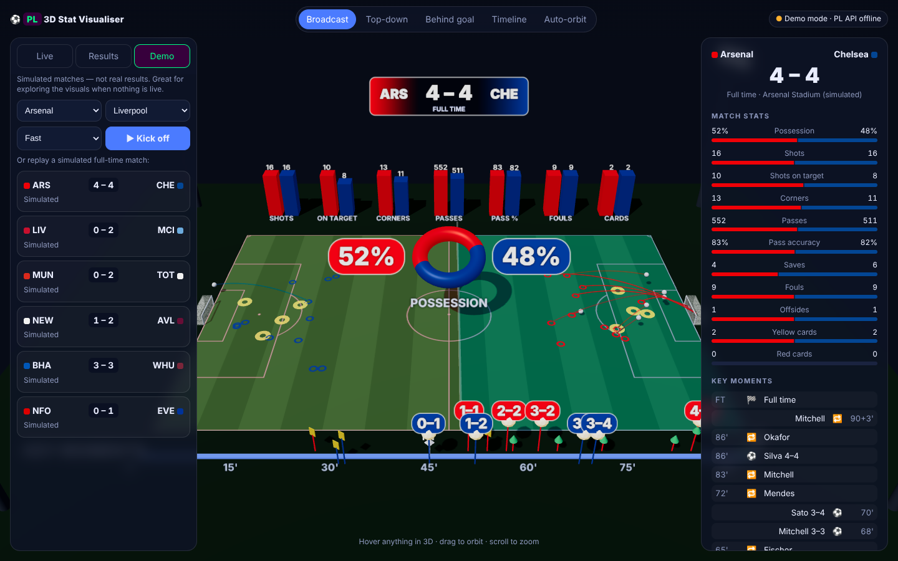

# PL 3D Stat Visualiser

A browser-based, 3D live stat visualiser for Premier League matches, built with Three.js.



## What you see

- **Score:** a floating 3D scoreboard in club colours with live clock / full-time status.
- **Possession:** a spinning 3D donut split by possession %, and each team's colour floods the pitch in proportion to its possession.
- **Shots:** every shot is a glowing 3D arc from where it was taken to the goal. Gold arcs are goals, solid arcs were on target, faint arcs were off target. A ball flies along each new shot.
- **Key moments:** a 3D timeline along the touchline with spinning balls for goals (with the score at that point), yellow and red cards, and substitutions. A red playhead marks the live minute.
- **Stat towers:** side-by-side 3D bars for shots, shots on target, corners, passes, pass accuracy, fouls and cards.
- **Goal celebrations:** confetti in the scorer's colours, a camera shake and a "GOAL!" banner when a goal arrives live.
- **Camera presets** (Broadcast, Top-down, Behind goal, Timeline, Auto-orbit). Drag to orbit, scroll to zoom, and hover anything for details.

## Data sources

| Tab | Source |
| --- | --- |
| **Live** | Live Premier League matches, refreshed every 20s. If nothing is live, it lists upcoming fixtures. |
| **Results** | Completed matches for any season, with a season picker and paging. |
| **Demo** | An offline match simulator. Pick two clubs and kick off a simulated "live" match, or replay simulated full-time results. |

Live data comes from two unofficial public feeds, tried in this order:

1. **The Premier League website's own data API** (`footballapi.pulselive.com`).
2. **ESPN's public Premier League feed** (`site.api.espn.com`), which needs no account or key.

Both feeds reject requests made directly from a browser (CORS), so requests go through a small proxy: `api/pl.js` and `api/espn.js` on Vercel, or `server.js` when running locally. The label in the top-right corner shows which feed is in use. If neither can be reached, the app switches to Demo mode and the Live tab shows the reason.

> **Note:** the public feed provides shot *totals* but not shot *locations*. The 3D shot positions for real matches are illustrative. They're laid out deterministically from the match ID, so they don't change between refreshes. Goals, cards and subs use the real minutes and players.

## Put it online with Vercel

1. Sign in at [vercel.com](https://vercel.com) with GitHub.
2. Click **Add New… → Project** and **Import** this repository.
3. Leave every setting as it is (Framework Preset: **Other**) and click **Deploy**.

Vercel picks up `vercel.json` automatically. It serves the `public/` folder and runs `api/pl.js` as a serverless function for the Premier League data.

## Run it on your own computer

Requires Node.js 18+. There's nothing to install.

```bash
npm start
# open http://localhost:3000
```

Environment variables (set them in Vercel under **Settings → Environment Variables**):

- `PL_API_BASE`: overrides the upstream API base if the Premier League changes its endpoint (default `https://footballapi.pulselive.com/football`).
- `PORT`: the port the local server listens on (default `3000`).

## Project layout

```
api/pl.js, espn.js   Vercel serverless functions: data proxies
lib/upstream.js      the shared code that fetches from the data feeds
server.js            local static server + the same proxy (no dependencies)
vercel.json          Vercel config (output folder + /api rewrites)
public/index.html    UI shell
public/styles.css
public/js/main.js    UI, tabs, live polling, simulation loop
public/js/data.js    picks a working data feed
public/js/api.js     Premier League feed → shared match model
public/js/espn.js    ESPN feed → shared match model
public/js/demo.js    offline match simulator
public/js/scene.js   Three.js stadium, possession, shots, timeline, towers, scoreboard
public/js/teams.js   club colours (with kit-clash handling)
public/vendor/three  Three.js r169 (MIT), bundled so no install step is needed
```

This is an unofficial fan project and isn't affiliated with the Premier League.
